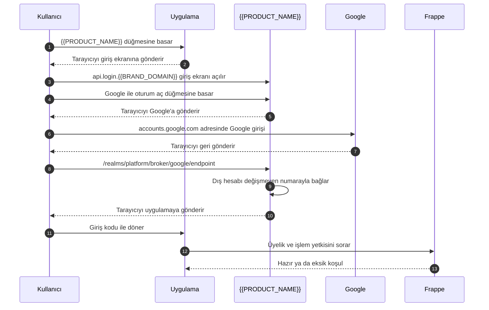

{{PRODUCT_NAME}} bir giriş ürünüdür. Kullanıcı uygulamaya bu ürünle girer. Ürünün adı tam olarak "{{PRODUCT_NAME}}" yazılır. Ürünün görünen adını ortak marka ayarı belirler.

Ürünün kararlarını proje sahibi 23 Kasım 2026 Pazartesi günü verdi. Kararlar kesindir. Sitedeki karar kaydı K-61'dir. Ürün P7 fazındadır.

Proje sahibi aynı gün ürünün geliştirilmesini başlattı. Backend kaydında bu karar O-56'dır. Ürünün ilk kodu yazıldı. Kod yerel testlerden geçti ve PR 23 ile yayımlandı. Ürün canlıda değildir. Bu yüzden sayfadaki kurallar hâlâ gereksinimdir. Çalışan bir sistemin özelliği değildir.

Bugünkü durum sayfanın sonundaki [Bugünkü durum](#bugünkü-durum) bölümündedir.

## Ürün nedir?

{{PRODUCT_NAME}}, uygulamalar için ortak bir giriş kapısıdır. Kullanıcı bir uygulamada "{{PRODUCT_NAME}}" düğmesine basar. Giriş ekranı açılır. Kullanıcı kimliğini doğrular ve uygulamaya döner.

Ürün üç gruba hizmet eder:

- **Platformun kendi uygulamaları.** Panel, kiracı siteleri ve sonraki uygulamalar bu kapıyı kullanır.
- **Ücretli müşteriler.** Bir şirket kendi uygulaması için {{PRODUCT_NAME}} ürününü satın alabilir.
- **Son kullanıcılar.** Kullanıcı tek hesapla birçok uygulamaya girer.

Ürün bağımsızdır. Bunun üç nedeni vardır:

1. Müşteri ürünü platformun geri kalanını almadan kullanabilir.
2. Giriş ayrı bir alan adında durur. Bu alan adı `{{BRAND_DOMAIN}}` olur.
3. Ürünün kendi tanıtım sayfası ve kendi fiyatı olur.

## Önce Keycloak, eksikleri Frappe tamamlar

Keycloak açık kaynak bir giriş sunucusudur. Ürün önce Keycloak üzerine kurulur. Keycloak'ın kodu değiştirilmez. Keycloak'ta eksik kalan işleri Frappe tamamlar. Frappe, platformun uygulama çatısıdır.

İş bölümü şöyledir:

| Konu | Kim yürütür? | Ne yapar? |
| --- | --- | --- |
| Giriş | Keycloak | Kişinin giriş kanıtını doğrular. Giriş yöntemlerini ve oturumu yönetir. |
| Platformla giriş | Keycloak | Google gibi platformlara gider ve sonucu alır. |
| Üyelik ve rol | Frappe | Kişinin hangi kuruluşa üye olduğunu ve rolünü tutar. |
| İşlem kararı | Frappe | Kişinin seçtiği işlemi yapıp yapamayacağını denetler. |
| Kimlik kontrolü | Dış sağlayıcı ve Frappe | Sağlayıcı belgeyi inceler. Frappe sonucu kendi kurallarıyla değerlendirir. |
| İnceleme kaydı | Frappe | Denemeleri, kararları ve itirazları kaydeder. |

Keycloak tek başına şu işleri yapmaz. Bu işleri Frappe yapar:

- **Giriş yetki değildir.** Örneğin kişi giriş yapmıştır ama kuruluş üyeliği yoktur. Bu kişi sipariş veremez.
- **Her işlemin koşulu ayrıdır.** Örneğin açık bir formu misafir gönderebilir. Deneme başlatmak ise doğrulanmış hesap ister.
- **Bekleme durumu ayrı tutulur.** Örneğin şirket girişi tamamdır ama üyelik bilgisi henüz gelmemiştir. Frappe bu durumu "hizmet sonucu bekleniyor" diye tutar.
- **Sınırlı hak tek kez tüketilir.** Örneğin son lisans yeri iki farklı istekle iki kez kullanılamaz.
- **Kural değişirse sonuç yenilenir.** Örneğin kural işlem sırasında değişirse eski "hazır" sonucu geçersiz olur.

Frappe her işlemde üç soru sorar:

1. Bu kontrol bu işleme uygulanıyor mu?
2. Kontrol uygulanıyorsa şart mı?
3. Güncel kanıt ne diyor?

Bilinmeyen zorunlu koşul işlemi açmaz. Bu kuralın gereksinimi G-161'dir.

İşlem kararının çekirdeği yazıldı. Çekirdek her işlemde en az bir zorunlu kontrol ister. Kontrolü olmayan işlem reddedilir. Bitiş zamanı olmayan kanıt geçerli sayılmaz. Çekirdek artık Frappe'ye bağlıdır. İşlem kararı için Frappe'de iki uç vardır. Birinci uç, bir işlemin şimdi yapılıp yapılamayacağını söyler. İkinci uç ücretli plan açar. Kanıtı sunucu kendi kayıtlarından toplar. Tarayıcıdan gelen kanıt ve roller okunmaz. Uçlar yerel testlerden geçti. Uçlar canlı sunucuda denenmedi.

## Giriş yolu ve adresler

Kullanıcının tarayıcısı şu adreslerden geçer:

1. Kullanıcı bir uygulamada "{{PRODUCT_NAME}}" düğmesine basar.
2. Tarayıcı giriş ekranını açar. Adres çubuğunda `api.login.{{BRAND_DOMAIN}}` görünür.
3. Kullanıcı "Google ile oturum aç" düğmesine basabilir. O zaman tarayıcı `accounts.google.com` adresine gider. Bu adres Google'ındır ve değiştirilemez.
4. Google işini bitirir. Tarayıcı `api.login.{{BRAND_DOMAIN}}` adresine geri döner.
5. Giriş sunucusu tarayıcıyı uygulamaya geri gönderir.

Dönüş yolunun örneği şudur: `https://api.login.{{BRAND_DOMAIN}}/realms/platform/broker/google/endpoint`. Yoldaki `platform` realm adıdır. Realm, Keycloak'taki kullanıcı ve ayar kümesidir. MVP'de realm adı değişmez. Öteki platformlar da aynı yolu izler. Tarayıcı önce platformun kendi adresine, sonra `api.login.{{BRAND_DOMAIN}}` adresine gider.

**Google ile giriş yolu**

Ortamların adresleri şöyledir:

| Ortam | Giriş adresi |
| --- | --- |
| Canlı ortam | `api.login.{{BRAND_DOMAIN}}` |
| alpha | `api.login.alpha.{{BRAND_DOMAIN}}` |
| beta | `api.login.beta.{{BRAND_DOMAIN}}` |
| rc | `api.login.rc.{{BRAND_DOMAIN}}` |

Ortam adresi `<servis>.<ortam tabanı>` kuralına uyar. Adres koda yazılmaz, ortam ayarından gelir. Eski `id.` adı kalktı. Ürün canlıda olmadığı için yönlendirme gerekmez. Bu kuralların gereksinimi G-158'dir.

DNS kaydını iki kişi hazırlar. DevOps sorumlusu kaydın değerlerini yazar. Alan adı sorumlusu kaydı `{{BRAND_DOMAIN}}` bölgesine girer. Sonra DevOps sorumlusu adresin çalıştığını doğrular.

## Birden çok platformla giriş

Kullanıcı birçok platformla oturum açabilir. Örnekler şunlardır: Google, Facebook, LinkedIn ve X. X'in eski adı Twitter'dır. Platform sayısı sınırlı değildir.

Platform listesi veriyle gelir. Kodda sabit liste olmaz. Bu kural şöyle çalışır:

1. Her platform bir veri dosyasıdır. Dosya ürün klasöründe durur.
2. Bir komut bu dosyalardan Keycloak'ın kimlik sağlayıcı kayıtlarını üretir.
3. Bir test, kayıtların veri dosyalarıyla aynı kaldığını denetler.
4. Giriş ekranı düğmeleri bu kayıtlardan çizer.
5. Yeni platform için yalnız yeni dosya eklenir. Kod değişmez.

Beş platformun kaydı hazırdır:

| Platform | Kayıt durumu |
| --- | --- |
| Google | Açılabilir |
| Apple | Açılabilir |
| LinkedIn | Açılabilir |
| Facebook | Kapalı |
| X | Kapalı |

Google, Apple ve LinkedIn geliştirici hesaplarını hesap sorumlusu açar (K-63). Hesaplar açılınca DevOps sorumlusu istemcileri bu hesaplarda açar.

Facebook ve X, e-postanın doğrulandığını Keycloak'a bildirmez. Bu yüzden iki kayıt kapalıdır. Önce ek bir denetim yazılır. Sonra kayıtlar açılır.

Platformun gizli anahtarı veri dosyasına yazılmaz. Dosya yalnız ortam değişkeninin adını yazar. Bütün değişkenleri dolu olan platform açılır. Bir değişken boşsa platform kapalı kalır. O zaman düğmesi giriş ekranında görünmez.

Kayıt güvenliği zayıflatan ayarları reddeder. Örneğin imza doğrulamasını ya da PKCE'yi kapatan kayıt reddedilir. Platform adresleri https kullanır. Dönüş adresi platformun panelinde tam adres olarak kayıtlıdır. Bu kuralların gereksinimi G-159'dur.

Gerçek platform hesapları henüz açılmadı. Bu iş dış iştir. DevOps sorumlusu her platformun kendi panelinde bir istemci açar. Ajan bu işi yapmaz.

## Dış hesap bağlama

Dış hesap e-postayla bağlanmaz. Bağ, platformun adı ve değişmeyen kullanıcı numarasıyla kurulur. Kural Keycloak'ta ayrı bir giriş akışıyla uygulanır:

1. Platform e-postanın doğrulandığını bildirmezse giriş reddedilir. Hesap açılmaz.
2. Aynı e-postalı hesap yoksa yeni hesap açılır. Kullanıcı e-posta adresini kendisi yazamaz.
3. Aynı e-postalı hesap varsa Keycloak kullanıcıya sorar. Kullanıcı bağlamayı onaylar.
4. Sonra kullanıcı var olan hesabın parolasıyla yeniden oturum açar.
5. E-posta eşleşmesi tek başına bağ kurmaz. E-postaya gelen bağlantı da bağ kurmaz.

Bu kurallar önceden ele geçirmeyi önler. Önceden ele geçirme, başkasının e-postasıyla o kişiden önce hesap açmaktır.

Parolası olmayan kullanıcı bu yolla bağ kuramaz. Bu kişi önce hesabına parola ekler. Bu kısıtlama bilinçlidir.

Kuruluş şirket girişini zorunlu kılabilir. O zaman kullanıcı sosyal platformla giremez. Bu kural bir role bağlıdır. Rolü veren üyelik kodu henüz yazılmadı. Bu kuralların gereksinimi G-160'tır.

### Şirket giriş sağlayıcısı

Şirket giriş sağlayıcısı, kuruluşun kendi giriş sistemidir. Bu sağlayıcı da e-postanın doğrulandığını bildirmelidir. Bildirmeyen sağlayıcı önceden ele geçirmeye açıktır.

DevOps sorumlusu `atonota-login apply` komutunu çalıştırır. Komut her şirket sağlayıcısını denetler. Komut şu durumlarda hata verir:

- Sağlayıcı e-postaya denetimsiz güvenir.
- Sağlayıcıda e-posta kuralı yoktur. Onaylı istisna kaydı da yoktur.
- İstisna kaydının süresi geçmiştir.

Komut sağlayıcıyı kapatmaz. Sağlayıcıyı kapatma kararını DevOps sorumlusu verir.

İstisna kaydı Frappe'de durur. Kaydı bir kişi ister. Başka bir kişi kaydı onaylar. Ajan kaydı onaylayamaz. Onaylanan kayıt değişmez ve silinmez. Değişiklik için yeni bir kayıt açılır.

Sosyal platform istisna alamaz. Kayıttaki alan adı kuruluşa ait olmalıdır. Herkese açık e-posta servisleri kabul edilmez. Örneğin `gmail.com` kabul edilmez. Alan adını DNS'te sorgulayan kod henüz yoktur. Bu kod yazılana kadar kayıt yalnız kanıt alanını zorunlu tutar.

## Kullanıcı yolculukları

Kaynak analiz 24 örnek yolculuk tanımlar. Her yolculuk ilk ziyaretten işlem yetkisine kadar gider. Aşağıdaki tablo bazı örnekleri kendi sözlerimizle özetler.

| Yolculuk | Ne olur? | Sonuç |
| --- | --- | --- |
| İlk ziyaret ve yeni deneme | Kişi e-postasını kanıtlar. Geçiş anahtarı kurar. Deneme hakkı uygundur. | Kişi son özeti onaylar. Sunucu denemeyi açar. |
| Davet yanlış hesapta | Tarayıcıda başka hesap açıktır. Davet bu hesaba ait değildir. | Kişi doğru hesabı seçer. Sistem daveti yeniden denetler. |
| Şirket girişi tamam, üyelik bekliyor | Kişi şirket hesabıyla girer. Şirketten üyelik bilgisi henüz gelmemiştir. | Sistem bekler. Bekleme uzarsa yöneticiye iş açar. |
| Misafir açık form gönderir | Form herkese açıktır. Hesap gerekmez. | Veri ve kötüye kullanım denetimi yine çalışır. |
| Lisans yeri kalmamış | Kuruluşta boş lisans yeri yoktur. | Sistem işlemi açmaz. Yönetici yer ekleyebilir. |
| Kamera açılmıyor | Kimlik kontrolü için kamera gerekir. Kamera açılmaz. | Kişi telefona geçebilir ya da izin verilen başka yolu seçer. |
| Aynı bildirim iki kez gelmiş | Sağlayıcı aynı sonucu iki kez gönderir. | Sistem ikinci bildirimi işlemez. |
| Hesap kapalı | Hesap kapatılmıştır. | Giriş açılmaz. Kişi güvenli bir yardım yolu görür. |

Bir kişi aynı anda iki durumda olabilir. Örneğin kişi giriş yapmıştır ve üyelik bekler. Bu yüzden giriş, üyelik, kimlik kanıtı ve işlem yetkisi ayrı sonuçlardır.

## Güvenlik kuralları

Analizin güvenlik kuralları şöyle özetlenir:

- **E-posta bağlantısı hesabı ele vermez.** Sistem herkese aynı yanıtı verir: "E-postanızı kontrol edin." Bağlantı tek kullanımlıktır. Kişi bağlantıyı açınca ayrıca onaylar (G-162).
- **Yöneticiler güçlü giriş kullanır.** Geçiş anahtarı ya da donanım anahtarı gerekir. Hassas işlem yeniden doğrulama ister (G-163).
- **Kurtarma ayrı incelemedir.** E-posta erişimi tek başına hesabı kurtarmaz. Yüz kontrolü de tek başına yetmez.
- **Kayıtlı cihaz kimlik kanıtı değildir.** Cihazı unutmak o cihazın oturumlarını iptal eder.
- **Çıkışın kapsamı sorulur.** Kişi bu oturumu, başka bir oturumu ya da bütün cihazları seçer.
- **Davet tek başına yetmez.** Daveti yalnız doğru alıcı kabul eder. Sistem süreyi ve iptali denetler.
- **Hesap değiştirmek kimlikleri birleştirmez.** Açık sekme eski hesabın yetkisiyle işlem yapamaz.
- **Destek çalışanı koşulları atlayamaz.** Zorunlu koşul eksikse destek de "hazır" sonucu veremez.

Oturum çerezi betiklere kapalıdır ve yalnız şifreli bağlantıda gider. Giriş akışı PKCE kullanır. PKCE, giriş kodunun çalınmasına karşı bir korumadır. Dönüş adresi izinli adresle tam eşleşir.

## Sunucu görevleri

Sunucu tarafında iş şöyle bölünür:

- Keycloak girişi, giriş yöntemlerini ve oturumu yönetir.
- Frappe üyeliği, işlem kuralını, kanıt bağını ve inceleme kaydını yönetir.
- İş kuralı yalnız Keycloak belirtecindeki eski role bırakılmaz. Sunucu her korunan istekte yeniden denetler.
- Her kaydın değişmeyen bir kimliği ve kuruluş kapsamı vardır.
- Ham belge ve yüz verisi karar kaydına kopyalanmaz.
- Dış sağlayıcının bildirimi imza denetiminden geçer. Sonra kalıcı gelen kutusuna yazılır. Aynı bildirim iki kez işlenmez (G-164). Gelen kutusu artık Frappe'ye bağlıdır. Bildirimi Frappe'deki `verification_notice` ucu alır. Doğrulama sağlayıcısı seçilmedi. Bu yüzden uç şimdilik her bildirimi geri çevirir. Doğrulamayı başlatan kod da henüz yoktur.

Analiz Frappe'de on kayıt türü önerir. Kayıt türleri şunlardır:

- işlem niyeti,
- üyelik,
- doğrulama dosyası,
- doğrulama denemesi,
- kanıt bağı,
- gerekli kişi kümesi,
- inceleme kararı,
- gelen bildirim kutusu,
- giden olay kutusu,
- işlem kaydı.

Bu kayıtlar henüz yoktur. Adları kurulumda kesinleşir.

Bazı kuralların değeri henüz belirlenmedi. Örneğin doğrulama sağlayıcısı seçilmedi. Değer boşken ilgili zorunlu işlem açılmaz. Sonuç "yapılandırma gerekiyor" olur (G-167). Bu kurallar ürün klasöründe bir veri dosyasındadır. Her kuralın sahibi dosyada yazılıdır. Kural boşsa Frappe bir görev açar. Görev "System Manager" rolüne açılır. Kural sahibinin adı görevin metnindedir.

## Tanıtım sayfası

Ürünün bir tanıtım sayfası olur (G-165). Sayfanın taslağı [{{PRODUCT_NAME}} tanıtımı](/frappesetup/atonota-login-tanitim/) sayfasındadır. Ürün sahibi taslağı henüz onaylamadı. Sayfanın kuralları aşağıdadır.

Sayfa şu değer önerilerini anlatır. Her öneri, yeteneği kurulunca tanıtım sayfasına girer:

- **Tek giriş kapısı.** Kullanıcı tek hesapla birçok uygulamaya girer.
- **Birçok platform.** Kullanıcı Google, Facebook, LinkedIn, X ve başka platformlarla girer. Yeni platform kod değişmeden eklenir.
- **Giriş ile yetki ayrıdır.** Giriş yapan kişi her işlemi yapamaz. Her işlemin koşulu ayrı denetlenir.
- **Güçlü giriş.** Geçiş anahtarı ve donanım anahtarı desteklenir.
- **Açık kaynak temel.** Ürün Keycloak üzerine kuruludur. Ürünün kodu MIT lisanslıdır.
- **Platform verisi Hetzner'de durur.** Bu kural platformun veri kararından gelir. Dış doğrulama sağlayıcısının verisi ayrıdır. Bu verinin bölgesi sağlayıcı seçilince belli olur (G-167).

Sayfanın kuralları şunlardır:

1. Sayfa yalnız var olan yeteneği "var" diye anlatır.
2. Yapılmamış özellik ayrı bir "yakında" bölümünde durur.
3. Fiyat kararı kapanmadan sayfada fiyat yazmaz.
4. Sayfa oturumsuz bir adresten sunulur.
5. Rıza yokken ölçüm satıcısına istek gitmez (G-134).
6. Sayfa sitenin arayüz kurallarına uyar. Örneğin sayfa 320 pikselde taşmaz.
7. Her değer önerisi bir gereksinime bağlıdır.

## Ücretli kullanım

Müşteri ürünü ücret karşılığında alıp kullanabilir. Plan, fiyat ve ölçü birimi açık karardır. Bu kararlar ürün sahibinindir. Bu sayfa fiyat yazmaz.

Tahsilat P2 ticari katmanının akışını kullanır. Ayrı bir ödeme altyapısı kurulmaz. Fiyat kararı kapanmadan ücretli plan açılmaz (G-166). Fiyat kuralının değeri bu yüzden boştur. İşlem kararı ücretli planı açmaz.

## Lisans

İki lisans birbirinden ayrıdır:

| Parça | Lisans |
| --- | --- |
| {{PRODUCT_NAME}} ürününün kodu: tema, eklentiler, Frappe uygulaması ve kurulum dosyaları | MIT |
| Keycloak | Apache-2.0 |

Keycloak'ın kodu ürüne kopyalanmaz ve değiştirilmez. Ürün Keycloak'ın eklenti yollarını kullanır. Bu kuralın gereksinimi G-157'dir.

Ürün klasörü kendi MIT lisans dosyasını taşır. Keycloak ve eklentileri ayrı bir listede durur. Bu liste Apache-2.0 lisanslı parçaları adlandırır. Bir olay eklentisi Apache-2.0 lisanslı bir çataldır. Bu eklenti kendi lisansını korur.

## Faz kararı

Ürün yeni P7 fazına bağlandı. P7, P1 ve P2 bitince açılır.

Kararın gerekçesi şudur:

- Var olan fazlar platformun kendi işlerini taşır.
- Ürün Keycloak girişine dayanır. Keycloak girişi P1'de kurulur.
- Ürün ücretlidir. Tahsilat P2'de kurulur.
- Ürün ayrı satılır. Bu yüzden kendi çıkış ölçütü olmalıdır.

Önce MVP'de yalnız çelişen yerler düzeltildi. Örneğin eski `id.` adresi `api.login.{{BRAND_DOMAIN}}` oldu. Proje sahibi sonra ürünün geliştirilmesini başlattı (O-56). Ürün P7 fazında kalır.

## Gereksinimler

Ürünün gereksinimleri G-157 ile G-167 arasıdır. Kalemler [Gereksinimler](/frappesetup/gereksinimler/) sayfasında P7 süzgeciyle görünür.

| Kimlik | Konu |
| --- | --- |
| G-157 | Ürün ve lisans sınırı |
| G-158 | Giriş adresi ve ortam adresleri |
| G-159 | Platform listesi veriden gelir |
| G-160 | Dış hesap bağlama ve zorunlu şirket girişi |
| G-161 | Frappe'de üyelik ve işlem kararı |
| G-162 | E-posta bağlantısıyla giriş |
| G-163 | Güçlü giriş, kurtarma, cihaz ve çıkış |
| G-164 | Dış kimlik doğrulama sonuçları |
| G-165 | Tanıtım sayfası |
| G-166 | Ücretli kullanım |
| G-167 | Değer bekleyen kurallar |

## Bugünkü durum

Bu bölüm 24 Kasım 2026 Salı günkü durumu yazar. Durumlar görev panosundaki durumlarla aynıdır. Yalnız G-157 "Bitti" durumundadır. Bu kalemin testi yalnız yerel yığında geçti. Öteki kalemlerin yerel testleri geçti. Ama her birinde kalan bir iş vardır.

| Kimlik | Durum | Kalan iş |
| --- | --- | --- |
| G-157 | Bitti | Kanıt `test_product_boundary.py` ve `brand.spec.ts` dosyalarıdır. Ad canlı sunucuda denenmedi. |
| G-158 | Sürüyor | DNS kaydı ve canlı adres denemesi dış iştir. |
| G-159 | Sürüyor | Gerçek platform hesapları açılmadı. Facebook ve X kapalıdır. |
| G-160 | Sürüyor | İstisna kaydı ve `apply` denetimi PR 27 ile yayımlandı. Yerel testler geçti. Bu iş canlıda denenmedi. DNS sorgusu ve rolü veren üyelik kodu yoktur. Üyelik kanıtı şimdilik masaüstü rolünden okunur. Masaüstü rolü, Frappe yönetim ekranını açan roldür. |
| G-161 | Sürüyor | İşlem kararı Frappe ucuna bağlandı. Uç yerel testlerden geçti. Uç canlı sunucuda denenmedi. |
| G-162 | Sürüyor | Bağlantı tek kullanımlıktır. Aynı yanıt ve ekranda onay denenmedi. |
| G-163 | Sürüyor | İkinci adım vardır. Kurtarma, cihaz ve çıkış kapsamı yoktur. |
| G-164 | Sürüyor | Bildirim ucu Frappe'de vardır. Uç yerel testlerden geçti. Sağlayıcı seçilmediği için uç her bildirimi geri çevirir. Doğrulamayı başlatan kod yoktur. Uç canlı sunucuda denenmedi. |
| G-165 | Sürüyor | [Tanıtım sayfası](/frappesetup/atonota-login-tanitim/) yazıldı. Ürün sahibi metni onaylamadı. |
| G-166 | Sürüyor | Fiyat kararı açıktır. Frappe'deki kapı `open_paid_plan` ucudur. Fiyat kuralı boş olduğu için kapı kapalıdır. |
| G-167 | Sürüyor | Kural boşsa Frappe bir görev açar. Görev "System Manager" rolüne açılır. Kural sahibinin adı görevin metnindedir. Bu kod `decision_api.py` dosyasındadır. Kod canlı sunucuda denenmedi. Kural sahipleri değerleri henüz girmedi. |

## Kaynak

Bu sayfa beş kaynağa dayanır:

- Proje sahibinin {{PRODUCT_NAME}} kararları, 23 Kasım 2026 Pazartesi günü.
- Backend proje kaydındaki O-51 ve O-56 kararları ve ürün klasörünün belgesi.
- Backend dalındaki `e7130aaa` ve `6730160f` birleşmeleri. Birinci birleşme işlem kararını Frappe'ye bağladı. İkinci birleşme bildirim ucunu ekledi. İki birleşme PR 25 ile yayımlandı.
- Backend dalındaki `43f13477` birleşmesi. Bu birleşme şirket sağlayıcısının istisna kaydını ekledi. Birleşme PR 27 ile yayımlandı.
- "Kurumsal kimlik ve erişim" analizi, 23 Kasım 2026 Pazartesi günü. Proje sahibi bu analizi yeterli buldu.

Analiz başka ürünlerin belgelerinden alıntılar ve görseller içerir. Bu içerik depoya kopyalanmadı. Sayfa analizi kendi sözleriyle özetler.
