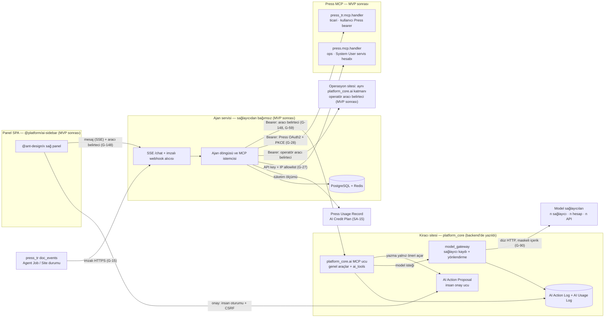

P1'de bu katmanın yalnız beta ortamında bir prototipi vardır (G-129). Bu ray P3 fazında teslim edilen ajan servisini, MCP kaynaklarını, niyet protokolünü, @ant-design/x sağ paneli ve güvenlik/KVKK katmanını kapsar (G-83..G-92). Her AI aksiyonu Rail 2'nin yetki motorundan (G-59, G-60, G-61) ve Rail 1'in ticari MCP'sinden (G-27, G-28) geçer; maliyet ve kota bağı X-07, kiracı CPU payı X-13, güvenlik test programı X-14 ile kapanır. AI kredisi ölçümü Press defterine yazılır (SA-15).

## 8.0 Backend durumu ve mimari kararı (D-9, D-11, O-10, O-13)

Bu bölüm backend'in 23 Kasım 2026 Pazartesi günkü durumunu anlatır. Kaynak `backend/PROJECT-RECORD.md`, `backend/docs/contracts.md` (10. ve 11. bölüm) ve karar notları 0002 ile 0004'tür. Canlı sunucu yoktur. Kod yalnız yerelde denendi.

- **Sağlayıcıdan bağımsız katman (D-9, O-10).** Yapay zekâ katmanı tek bir model sağlayıcısına bağlı değildir. Model ve sağlayıcı ayardan gelir. Eski K9 kararındaki Claude Agent SDK seçimi artık zorunlu değildir.
- **Çok sağlayıcı (D-11).** Sisteme birden çok sağlayıcı eklenebilir. Her sağlayıcıya birden çok hesap, her hesaba birden çok API eklenebilir.
- **Model geçidi (O-13).** Geçit `platform_core` içindeki `model_gateway` modülüdür. Geçit sağlayıcılara düz HTTP ile bağlanır. Sağlayıcı kitaplığı kullanılmaz.
- **Model adı kodda yok.** Model adları yalnız kayıtta durur. Bu sayfa da model adı yazmaz.
- **Kiracı katmanı.** `platform_core.ai` modülü kiracı sitesinin MCP ucunu, genel araçları, öneri ve onay akışını ve AI Action Log kaydını sunar. Bu kod backend'de yazıldı.
- **Henüz olmayanlar.** Ajan servisi (`agent-service`), `@platform/ai-sidebar` paneli ve Press MCP sunucuları backend'de yoktur. Bunlar MVP sonrası hedeftir. Aşağıdaki çizim ve tablolar bu hedefi de anlatır.

## 8.1 MCP topolojisi (G-84)

| MCP kaynağı | Kimlik | Araç sınıfı | Denetim izi | Durum |
| --- | --- | --- | --- | --- |
| Kiracı `platform_core.ai` | Site aracı belirteci → `auth_hooks` adaptörü (G-148, G-59); onay yalnız insan oturumundan | Genel araçlar (`search_doctypes`, `get_doctype_schema`, `list_documents`, `get_document`, `run_report`, beş yazma aracı, `get_proposal`), yönetim araçları, uygulama araçları (G-105) | Version + AI Action Log (G-64, G-87); model çağrısı AI Usage Log'da | Backend'de yazıldı, yerelde denendi |
| `press.mcp.handler` (Press Settings.enable\_mcp=1) | System User servis hesabı, IP allowlist | Sunucu/bench/site ops; yalnızca iç ekip ajanı (SA-39) | Agent Job + Site Activity (doğrulandı) | MVP sonrası |
| `press_tr.mcp.handler` | Kullanıcıya bağlı Press bearer (OAuth Client + PKCE, G-28) | list\_marketplace\_apps, get\_app\_plans, install\_app, change\_app\_plan, change\_site\_plan, get\_invoices, get\_upcoming\_invoice, get\_agent\_job\_status, buy\_credits; yazanlar önce öneri açar | Agent Job, Site Activity, Invoice | MVP sonrası |
| Operasyon sitesi `platform_core.ai` | Operasyon sitesinin bastığı operatör aracı belirteci (`ops-*` rolleri) | müşteri 360 özeti, ticket taslakları, mutabakat raporu okuma (SA-24) | AI Action Log + Operator Audit (SA-26) | MVP sonrası (O-17) |

`frappe/mcp` deposu (`frappe_mcp`) arşivlendi ve kullanılmaz. Frappe 16'nın hazır `/api/v2/mcp` ucu önizleme, onay ve günlük taşımaz. Bu yüzden `platform_core` bu ucu kiracı sitesinde kapatır. Kendi MCP ucu Frappe'nin protokol modüllerini yeniden kullanır (karar notu 0002).

**Araç katmanı (karar).** Frappe REST/RPC modele ham açılmaz: tipli domain adaptörü → semantik araç katmanı (arama, detay, analiz, taslak, rapor, metadata) → MCP/agent araçları. Her araç kapsamını (belge türü, alan, işlem) ve gereken yetkiyi bildirir; yetki sunucuda doğrulanır (G-84, G-85). DocType alan, zorunluluk, seçenek, ilişki, izin ve workflow metadata'sı semantik form ve yetenek şemasına, rapor tanımı filtre, metrik, grafik, tablo ve detay modeline derlenir; tablodaki belge araçları bu adaptör üzerinden kapsamlıdır. Ham SQL, ham Python, kabuk ve "Server Script" aracı yoktur.

## 8.2 Ajan servisi ve model geçidi (G-83)

- **Ajan servisi (MVP sonrası).** Stateless işçiler; Docker Engine konteyneri, PostgreSQL (konuşma, önizleme, kota sayaçları), Redis (kuyruk, oran sınırı), SSE akış ucu, imzalı webhook alıcısı. Servis sağlayıcıdan bağımsız bir MCP istemcisidir. Servis model sağlayıcısına doğrudan bağlanmaz. Model isteği `platform_core.ai` katmanından model geçidine gider. Konteyner, DB, TLS ve ağ kuralları: DevOps sorumlusu. `agent.` adı backend ad haritasında yoktur. Bu ad MVP sonrası hedeftir. Kaydın değerini DevOps sorumlusu hazırlar, alan adı sorumlusu GoDaddy'de uygular, DevOps sorumlusu doğrular.
- **Sağlayıcı kaydı (backend'de yazıldı).** Kayıtlar `AI Provider`, `AI Account`, `AI API`, `AI Model`, `AI Route` ve `AI Usage Log` türlerindedir. Kaydı yalnız "AI Manager" ve "System Manager" rolleri yönetir. Kiracı kendi sağlayıcılarını ekleyebilir (O-14).
- **Bağdaştırıcılar.** İlk bağdaştırıcılar OpenAI uyumlu sohbet biçimi, Anthropic Messages biçimi, Google Gemini biçimi ve yerel sunucudur (örneğin Ollama). Yeni sağlayıcı eklemek kod istemez. Yeni bir biçim yalnız yeni bağdaştırıcı ister.
- **İş rolleri ve yol kaydı.** Model seçimi kodda değil, `AI Route` kaydındadır. Yol kaydı gereken yetenekleri ve sıralı model ile API listesini taşır.

| Rol | Gereken yetenek | Not |
| --- | --- | --- |
| Niyet sınıflandırma, PII tespiti, içe aktarmada sütun→alan önerisi | Hızlı ve ucuz model, araç çağrısı | Yol kaydı seçer; sınıf yalnız ipucudur |
| Standart aksiyonlar, tek tık akışları | Araç çağrısı, yapılandırılmış çıktı | Eval ile ayarlanır |
| Çok adımlı/riskli aksiyonlar, önizleme üretimi | Uzun bağlam, araç çağrısı | Her yazma yine öneri ve insan onayı ister |

- **Yönlendirme.** Geçit kapalı, yeteneği eksik, bütçesi dolmuş ve devresi açık adayları çıkarır. Kalanları öncelik, ağırlık ya da en düşük maliyete göre sıralar. 429 ya da 5xx gelirse adayı bir süre dinlendirir ve sıradakine geçer. Bütçeli hesapta zaman aşımı olursa sıradakine geçmez: kayıt "unknown" kalır ve kullanıcı 503 alır. Zamanlanmış iş yoktur (O-15).
- **Sırlar.** API anahtarı "Password" alanında şifreli durur. Hiçbir uç ve hiçbir yapay zekâ aracı anahtarı dönmez. Ajan servisinin sırları ortam değişkeni/age ile verilir (G-112).
- **Saklama ve işleme.** Konuşma kayıtları Hetzner'deki PostgreSQL'de saklanır. Model işlemesi yol kaydının seçtiği sağlayıcıda yapılır. Dış sağlayıcı seçilirse bu bir yurt dışı aktarım olabilir (G-90).
- **Kredi ölçümü (MVP sonrası).** Token ve maliyet her çağrıda AI Usage Log kaydına yazılır. Her tur sonunda bu tutar takımın `AI Credit Plan` Usage Record'una System User servis hesabıyla yazılır; kredi atomik rezervasyonla düşülür: tur başında tahmini üst sınır rezerve edilir (idempotensi anahtarı = tur kimliği), tur sonunda gerçek kullanım tüketilir ve artan bırakılır; eşzamanlı çağrılar aynı bakiyeyi harcayamaz, zaman aşımında rezervasyon düşer; yetersiz bakiyede ücretli araçlar kilitlenir ve panel 'Kredi yükle' eylemini gösterir (SA-15).

## 8.3 Niyet protokolü (G-86, G-88, G-105)

1. Panel her turda yapılandırılmış bağlam zarfı gönderir: `{site, user, route, doctype, docname, selected_names[], filters, installed_apps[], roles[], locale}`; belge içeriği araç çağrısıyla sunucu tarafında okunur.
2. Sınıflandırma rolündeki yol, maskelenmiş metin üzerinde mesajı yönlendirme sınıfına atar (`read`, `navigate`, `write`, `destructive`, `billable`, `unknown`). Sınıf yalnız ipucudur. Onay kapısını aracın tanımı ve sunucu belirler (G-86). Araç tanımı yetki gereksinimini, yıkıcı ve ücretli bayraklarını taşır (G-84).
3. Araç listesi kullanıcının kurulu uygulamaları, rolleri ve sınıfa göre daraltılır (G-84).
4. Yazma aracı (`write`, `destructive`, `billable`) kaydı yazmaz, yalnız öneri açar. Sunucu girdiyi ve izni denetler. Sonra her alanın eski ve yeni değerini gösteren önizlemeyi üretir. Öneri 10 dakika geçerlidir. Model `approval_required` durumunu, öneri kimliğini ve önizlemeyi alır.
5. Panel öneriyi insana gösterir. İnsan onayı ayrı bir uçtan verir: `platform_core.api.ai.approve_proposal`. Bu istek insan oturumundan ve CSRF belirteciyle gelir. İstek öneri kimliğini ve önizleme özetini taşır.
   - Modelde onay aracı ve `confirm` alanı yoktur. Araç girdisinde `confirm`, `approved` ya da `force` alanı gelirse çağrı reddedilir.
   - Sunucu onay anında şunları denetler: onaylayan öneriyi açan kullanıcıdır, öneri `pending` durumundadır, süre dolmamıştır, özet kayıttaki özetle aynıdır, kaydın `modified` değeri değişmemiştir, izin hâlâ vardır ve aynı hedefte sonucu bilinmeyen iş yoktur.
   - Özete rastgele bir değer girer. Bu yüzden model özeti hesaplayamaz. Onay isteğinin kendisi tek kullanımlık yürütmedir.
   - Her öneri tek iştir. Zincirli yazma yoktur. Sonucu bilinmeyen iş "unknown" kalır ve aynı hedefe kör tekrar yapılmaz.
6. Sonuç AI Action Log'a ve ilgili Version kaydına yazılır. Model, token ve maliyet model geçidinin AI Usage Log kaydına yazılır (G-64, G-87).

| Sınıf | Örnek araç | Kapı |
| --- | --- | --- |
| read / navigate | get\_list, get\_doc, run\_report, open\_route | has\_permission + Access Rule |
| write | `create_document`, `update_document` (tek kayıt) | öneri + insan onayı zorunlu (G-86) |
| destructive | `delete_document`, `cancel_document`, `submit_document`, apply\_workflow | öneri + insan onayı zorunlu |
| billable | install\_app, change\_app\_plan, change\_site\_plan, buy\_credits | öneri + insan onayı + Press Role allow\_billing/allow\_apps (G-16) |

Uygulamalar `ai_tools` hook'uyla araç şemasını, gereken rolü, `destructive/billable` bayrağını, önizleme üreticisini ve Prompts (tek tık akışları) bildirir (G-105); HRMS TR ilk örnektir: izin onayı, bordro kontrol özeti (G-108).

Kabul testleri süresi dolan onayı, tekrar gönderimi ve başka kullanıcının onayını reddetmelidir. Testler belge veya fiyat değiştiğinde eski onayı da reddetmelidir.

## 8.4 @ant-design/x arayüzü (G-88)

| İhtiyaç | Bileşen |
| --- | --- |
| Mesaj akışı, SSE | Bubble.List + XStream / useXAgent |
| Giriş ve ek dosya | Sender, Attachments (Frappe `upload_file`) |
| Konuşma geçmişi | Conversations |
| Tek tık akışları, bağlama göre öneri | Prompts, Suggestion |
| Araç çağrısı adımları | ThoughtChain |
| Önizle / onayla / iptal | Actions |

Bileşen adları kurulu @ant-design/x sürümünde doğrulanır (doğrulanacak). Yapılandırılmış mesaj, katalog içeriği ve artifact X Cards (A2UI) ile çizilir; AI yalnız onaylı katalogdan deklaratif tanım üretir, açık üretken UI yalnız izole sandbox'tadır ([Rail 3](/frappesetup/rail-3-frontend/), SEC-10). Panel 320 px'te tam ekran Drawer, geniş ekranda sağ sütun; tasarım tokenları ConfigProvider üzerinden (G-67); tek `:focus-visible` göstergesi, ≥1rem metin, WCAG 2.2 AA, tüm aksiyonlar klavyeyle erişilir. Press bildirimleri ve başarısız Agent Job'lar aksiyon alınabilir öğe olarak panele düşer (G-100); plan yükselt / uygulama etkinleştir / kredi yükle aynı önizle+onayla ile (G-27, G-30, SA-6). Playwright matrisi (G-74) AI panelini kapsar.

## 8.5 Yetki eşitliği ve prompt injection (G-85, G-89, X-14)

- Kiracı verisine erişen her araç çağrısı, kiracı sitesinin kullanıcı adına bastığı kısa ömürlü aracı belirteciyle (G-148, G-59; K-25) Frappe `has_permission`, Access Rule (G-60) ve permlevel (G-61) katmanından geçer; Press aksiyonları kullanıcıya bağlı Press bearer ile yürür.
- Araç sonuçları ve belge içerikleri yapılandırılmış veri bloğu olarak iletilir; operatör talimatı yalnızca system kanalındadır.
- Tur başına üst sınırlar: 12 araç çağrısı, 120 s süre, 16K çıktı token; takım başına Redis oran sınırı ve plan kotası (G-92). Backend'deki aracı belirteci en çok 300 saniye ve en çok 20 araç çağrısı geçerlidir.
- Şüpheli talimat kalıbında aksiyon durur ve kullanıcıya gösterilir; negatif testler (yetkisiz doctype, kayıt kuralı dışı belge, permlevel alanı, başka takımın sitesi, onaysız yıkıcı çağrı) AI Action Log'a `denied` yazar ve CI kırmızı takım eval setinde koşar.

## 8.6 KVKK, denetim, ölçüm ve kota (G-87, G-90, G-91, G-92, X-07)

- Her dış model sağlayıcısı veri envanterine ve aydınlatma metnine 'AI işleme' alıcısı olarak işlenir; kiracı admin AI özelliğini takım düzeyinde kapatabilir; her sağlayıcının saklama ve eğitim dışı tutma koşulları sözleşmede teyit edilir (doğrulanacak).
- İlk dış model çağrısından önce (sınıflandırma dahil) yerel ve deterministik veri seçimi ve maskeleme uygulanır: araç yalnız gereken alanları döner, permlevel ile gizli alanlar gönderilmez, TCKN/VKN/IBAN/kart ve ortak sözlükteki sınıflar regex + alan sınıfıyla maskelenir; ham kişisel veri dış modele gitmez; maskeleme kuralları golden testlerde yer alır ve Rail 6 ortak maskeleme sözlüğüyle paylaşılır (SA-36). Model geçidinde dış sağlayıcıya giden içerik her zaman maskelenir. Yolun veri kısıtını "AI Manager" rolü seçer.
- Saklama: AI Action Log 365 gün, AI Usage Log 365 gün, konuşma içeriği 90 gün (G-52 ve G-87 ile uyumlu). Mesaj içeriği varsayılan olarak günlüğe yazılmaz. Saklama Hetzner'dedir. İşleme seçilen sağlayıcıdadır. Aktarım mekanizması hukukça belirlenir (G-116).
- Kota ve kredi: Marketplace App Plan features'ta aylık mesaj/token kotası; aşımı Press `Balance Transaction` defterinden düşen AI kredisiyle karşılanır, ek kredi iyzico ile yüklenir (SA-6, SA-15); agent DB sayaçları kalan kota ve bakiyeyi panele döner; aşımda yumuşak sınır + plan yükseltme önerisi. Birim fiyatlar `AI Model` kaydındadır. X-07 tablosu bu kayıttan beslenir. Bu sayfa model adı ve fiyatı yazmaz.
- Kalite kapıları (G-91): Türkçe golden konuşma seti, araç seçimi doğruluğu, yanlış yıkıcı aksiyon = 0, yetki ihlali = 0; izler GlitchTip + OpenTelemetry; model/prompt sürümleri kayıtlı; kademeli dağıtım.

## 8.7 P3 teslim sırası ve kabul

| Adım | Çıktı | Sahip |
| --- | --- | --- |
| 1 | Ajan servisi konteyneri, PostgreSQL/Redis, TLS, ağ allowlist, DNS kaydı | DevOps sorumlusu (DNS uygulaması: alan adı sorumlusu) |
| 2 | Press OAuth Client + `press_tr.mcp.handler` (G-27, G-28); Keycloak `agent-service` servis hesabı; kiracı sitesinde aracı belirteci basımı (G-148, G-82) | Platform ekibi |
| 3 | platform\_core `auth_hooks`, `ai_tools` kaydı, AI Action Log (G-59, G-64); backend'de yazıldı | Platform ekibi |
| 4 | Niyet protokolü, öneri ve insan onay ucu, model geçidi ve sınıflandırma yolu, PII maskeleme; öneri, onay ve geçit backend'de yazıldı | Platform ekibi |
| 5 | `@platform/ai-sidebar` paketi + Playwright kapsamı | Frontend ekibi |
| 6 | AI Credit Plan + Usage Record ölçümü, atomik kredi rezervasyonu (SA-15) | Platform ekibi + AI ekibi |
| 7 | Eval seti, kırmızı takım testleri, KVKK envanter güncellemesi | Platform ekibi + hukuk |

Kabul: panelden en az üç tek tık akışı prod'da çalışır; her yazma ve yıkıcı/ücretli aksiyon onay olmadan yalnızca önizleme döner; her araç çağrısı kullanıcının Frappe/Press yetkisiyle yürütülüp AI Action Log'a düşer; prompt injection ve yetki aşımı negatif testleri geçer; dış sağlayıcı aktarımı KVKK envanterine işlenmiştir; AI tüketimi Press Usage Record'da görünür.

## 8.8 Saklama süresi dolan kayıtlar

Yönetici saklama temizliğini `platform_core.api.ai.purge_logs` ile elle başlatır. Sistem süresi dolan kayıtları kalıcı siler. Bu kural her modülde geçerlidir.

Sistem `delete_permanently=True` kullanır. Böylece “Deleted Document” tablosunda kopya kalmaz. Geri dönüş gerekirse veritabanı yedeği kullanılır.

Sistem geri yükleme kopyasını yalnız yönetici bir iş kaydını elle silerse tutar.

Kalıcı silme kuralını proje kaydı O-32 ve sözleşmenin 10. bölümü tanımlar.
